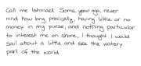

# handwriting-helper

Turn text into G-code that a 3D printer can plot in something that looks like human handwriting — in one command, with nothing sent anywhere.

```
./handwrite.py --file letter.txt -o output/letter.gcode --profile ender3
```



The handwriting comes from [calligrapher.ai](https://www.calligrapher.ai/), a recurrent neural net trained on the IAM On-Line Handwriting Database. A complete offline copy lives in `website/`, and this tool drives it in headless Chromium, so the model runs on your machine and no text leaves it.

## Why this exists

Plenty of programs turn an SVG into G-code, but not usefully for handwriting:

- calligrapher.ai's own SVG export outlines and fills each stroke, so the G-code traces around the edges of the letters instead of writing them.
- The [original model repo](https://github.com/sjvasquez/handwriting-synthesis) does emit stroke lines, but it is old enough to be difficult to run, and so are its forks.
- The site's JavaScript is obfuscated, so the stroke data it generates internally is not exposed through any UI.

So this reaches into the page for the raw stroke points, and keeps the explicit pen-up / pen-down information all the way through to the G-code. Nothing has to infer where a pen lift belongs, because it was never thrown away.

## Install

```
git clone --recurse-submodules https://github.com/Aptimex/handwriting-helper
cd handwriting-helper

python3 -m venv .venv && . .venv/bin/activate
pip install -r requirements.txt
playwright install chromium          # one-off, ~120 MB
```

Python 3.11 or newer. If you already cloned without `--recurse-submodules`, run `git submodule update --init` (the `fitCurves` submodule is needed for `--smooth`).

## Use

```
# a single line, straight to G-code
./handwrite.py "Hello world" -o output/hello.gcode --profile ender3

# a whole letter, broken into lines that fill the page, onto as many pages as it takes
./handwrite.py --file letter.txt -o output/letter.gcode --profile ender3 --page a5

# see it before you print it
./handwrite.py --file letter.txt -o output/letter.gcode --preview output/letter.svg

# SVG instead, if you'd rather keep your own G-code workflow
./handwrite.py --file letter.txt -o output/letter.svg
```

A text that runs past one page is written as numbered files — `letter-p1.gcode`, `letter-p2.gcode`, and so on — one per sheet of paper.

Generating is the slow, random part. Save the strokes once and you can re-render them — SVG or G-code, a different profile, smoothing, simplification — without generating again:

```
./handwrite.py --file letter.txt --save-strokes output/letter.strokes.json -o output/a.gcode
./handwrite.py --strokes output/letter.strokes.json --smooth -o output/b.gcode
```

Line breaks are chosen while generating, against the page width at the requested size. So re-laying saved strokes onto a narrower page or at a larger `--x-height-mm` won't re-break them; you get a warning if they overrun the margins, and should generate again instead.

Run `./handwrite.py --help` for the full list. The options worth knowing:

| Option | What it does |
|---|---|
| `--style N` | One of 80 handwriting styles (the website exposes only 9). Fixed for the whole document; `random` picks one and reports it. |
| `--bias F` | Legibility, 0.15 (loose and scrawly) to 2.5 (neat). |
| `--seed N` | Makes the output reproducible — the same seed gives byte-identical strokes. Without one, a seed is chosen and printed, so a run you like can be repeated. |
| `--x-height-mm` | Physical size, measured on letters like `n`. 3 mm is normal handwriting. |
| `--wrap N` \| `fit` | Line length. `fit` (the default) fills the width between the margins; a number asks for lines of about N characters. |
| `--keep-breaks` | Honour the line breaks in your input instead of reflowing each paragraph. |
| `--page`, `--margin`, `--align`, `--line-pitch` | Page layout. `--page fit` crops to the ink. |
| `--smooth` | Fits cubic beziers to the strokes. Looks better at large sizes. |
| `--simplify-tol 0.05` | Drops redundant points. Roughly halves the file for no visible change. |
| `--dry-run-z 5` | Raises both pen heights, so you can watch the motion without touching paper. |

## How lines are broken

Most of the difficulty in laying out generated handwriting is that you don't know how wide a line of it will be until it has been drawn: the 80 styles' letter widths differ, and so does every sample of the same style. Predicting a character count and hoping it fits leaves you choosing between lines that overrun the margin and lines that stop well short of it.

So nothing is predicted. Each line is drawn with more words than should fit, and then cut back:

1. Draw the next ~1.5 lines' worth of words as one sequence.
2. Find where each word's ink ends. The model's attention says which character it is writing at every step, so each point of ink belongs to a known word. A word ends at the last pen lift before the model starts on the next word.
3. Keep the longest run of whole words whose ink stays inside the line width. The words after it start the next line.

The model writes strictly left to right, so the part that is kept is a genuine sample of the shorter text, not an approximation of it. Lines come out within the margins every time, and typically 90–98% full. Sampling stops as soon as the pen passes the line width, so the extra words cost almost nothing.

Two of the model's own quirks are handled on the way:

- **The 50-character input cap is only the website's.** The model itself happily draws 180 characters in one go, which is longer than a line on any ordinary page, so each line is one draw's ink — there are no seams to hide.
- **Stalls.** Occasionally attention sticks on one letter and the pen runs off to the right writing "enenenen". The sampler notices the pen travelling several characters' width without attention moving on, stops, and that line is redrawn with a fresh seed.

A word too wide for a line on its own is split across lines. Input that arrives already hard-wrapped is reflowed paragraph by paragraph first, otherwise every original line break would leave a short orphan behind; blank lines still separate paragraphs. Use `--keep-breaks` for text where the line breaks are deliberate, such as an address block or a poem.

Pages are then simple: every line is the same pitch apart, so a page holds a fixed number of lines and the rest continue on the next.

## Printer profiles

G-code is written from a profile. Two are included, both commented: `profiles/ender3.toml` for a 220 × 220 mm bed, and `profiles/generic-256.toml` for the 256 × 256 mm beds most current machines use. Copy one and edit it. `--profile` takes either a name from `profiles/` or a path to a `.toml` file.

The number that matters is `pen_down_z`. Home the machine, jog Z down until the pen just marks the paper, and use that value. Then check the result before committing to it:

```
./handwrite.py "test" -o output/test.gcode --profile generic-256 --dry-run-z 5
tools/gcode_preview.py output/test.gcode -o output/test.preview.svg
```

`tools/gcode_preview.py` renders a G-code file back to SVG — drawing moves in black, travel moves in red. It is the cheapest way to catch an inverted axis or a pen that never lifts.

No profile ever emits heater, fan or extruder commands. If your machine needs any, put them in the profile's `preamble`.

`handwrite.py` refuses to write G-code that would run off the bed, if the profile declares one. Note that an A4 page fits neither a 220 nor a 256 mm bed: use `--page a5`, `--page fit`, or a custom size such as `--page 200x200`.

## How it works

```
text
  └─ split into paragraphs of words
      └─ headless Chromium loads website/ once, for its model
          └─ each line: draw extra words, cut back to the ones whose ink fits the width
              └─ strokes in model units, baseline-relative and length-independent
                  ├─ layout: scaled to millimetres, stacked on a baseline grid, paginated
                  ├─ SVG:    one <path> per stroke, dimensions in mm
                  └─ G-code: one pen-down move per stroke, from a printer profile
```

The page is used only for its model. Its script declares everything as top-level globals, so `handwriting_helper/generate.py` runs its own sampling loop on the page's encoder, sampling step and weights instead of pressing the Draw button. That matters because the page's own draw handler **scales glyphs by the character count** (`v = min(105/n, 11)`), so a 50-character line comes out about five times smaller than a 10-character one. Sampling directly yields the model's own pen offsets, in which a letter is the same size whatever line it is in.

The 80 style vectors differ in size by more than 4×, so `--x-height-mm` needs to know the chosen style's size. That depends on the style alone — bias moves it by under 5% — so it is measured once per style and shipped in `handwriting_helper/styles.json`. `tools/build_style_table.py` rebuilds it (a few minutes) if the model ever changes.

Measuring an x-height needs a little care, and `strokes.estimate_x_height` explains why. Removing a straight baseline fit is not enough, because real drift is not linear: the leftover wander grows with line length, and a whole-line measurement makes a 45-character sample read about 28% taller than a 9-character one even though the letters are the same size. Measuring in fixed-width windows instead holds to within 4% across those lengths.

### Limitations

- The model's vocabulary is 77 printable characters; anything else is drawn as garbage and warned about. Digits in particular are the model's weakest output.
- Every line is sampled separately, so a stray flourish or a misformed first letter is possible. Re-run with a different `--seed`, or edit the saved strokes file.
- The model now and then leaves out punctuation, most often a full stop at the very end of a paragraph.

## The offline site copy

`website/` is a snapshot of calligrapher.ai taken from the [Web Archive](https://web.archive.org/web/20240924102434/https://www.calligrapher.ai/), with Google Analytics removed and `d.bin` — the 2.65 MB model — saved locally. The network itself is hand-written vanilla JavaScript, not TensorFlow.js, which is why it loads in about a second and needs no ML dependencies.

`handwrite.py` serves that directory on a random local port and intercepts the `d.bin` request, so the copy needs no edits. To use it by hand instead, see `website/README.md`.

## Tests

```
tools/selftest.py            # paragraphs, word segmentation, layout and pagination, output
tools/selftest.py --online   # also generation: reproducibility, scale, long draws, line filling
```

## Alternatives

- If you don't mind the uniform look of a font, skip all of this and generate G-code from an [engraving font](https://www.evilmadscientist.com/2019/hershey-text-v30/) in Inkscape.
- [otuva/handwriting-synthesis](https://github.com/otuva/handwriting-synthesis) is a TensorFlow 2 fork of the original model with pretrained weights, if you'd rather have a pure-Python generator than a browser. It is archived, and its output differs from calligrapher.ai's.
- [utrost/VHS](https://github.com/utrost/VHS) builds plotter handwriting from a library of hand-drawn glyphs rather than a neural net, and has its own page layout engine.
- [vpype](https://github.com/abey79/vpype) with [vpype-gcode](https://github.com/plottertools/vpype-gcode), or [svg2gcode](https://github.com/sameer/svg2gcode), if you want to take the SVG output through a general-purpose plotter toolchain instead.

## License

GPL-3.0-or-later. The `fitCurves` submodule is MIT.
